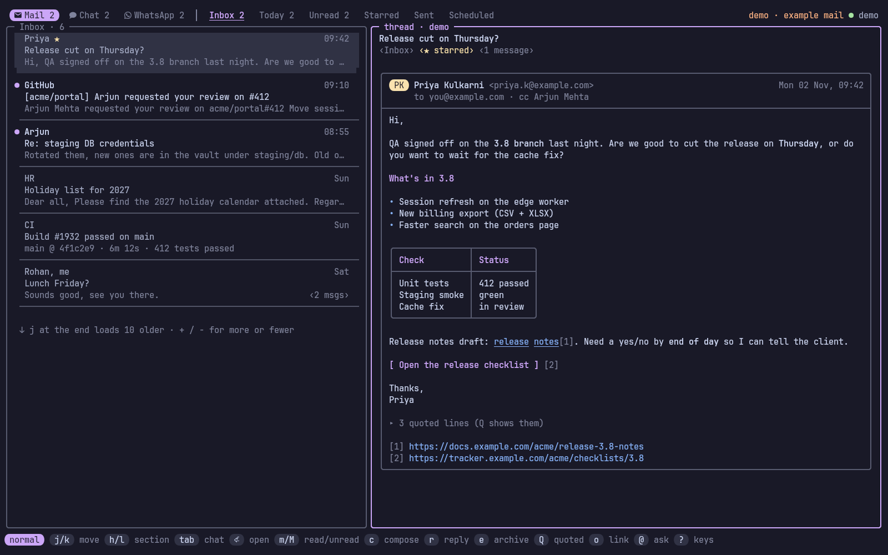
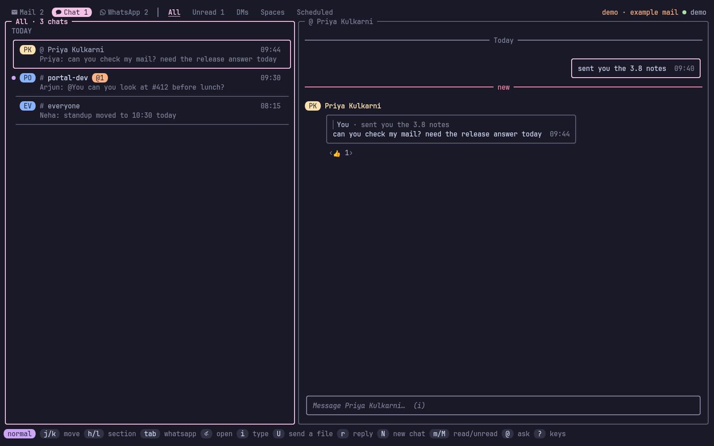
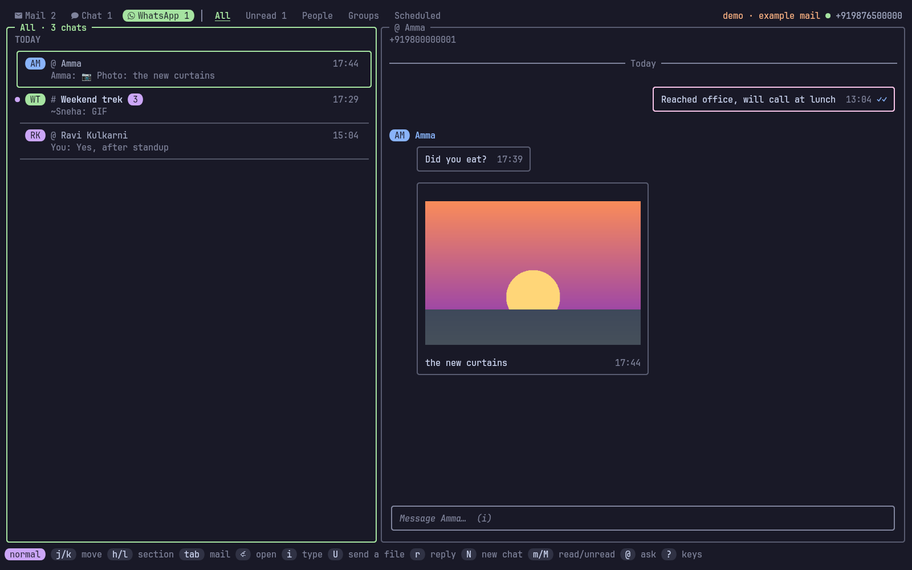

<p align="center">
  
</p>

<!-- identity -->
<p align="center">
  <b>अश्वत्थः सर्ववृक्षाणां देवर्षीणां च नारदः ।<br>
  गन्धर्वाणां चित्ररथः सिद्धानां कपिलो मुनिः ॥</b><br>
  <i>Among trees I am the sacred fig; among divine sages, Nārada.</i><br>
  <sub>Bhagavad Gītā 10.26</sub>
</p>
<!-- /identity -->

<p align="center">
  <b>Gmail, Google Chat and WhatsApp without leaving the terminal.</b><br>
  Every unread mail and chat in one keyboard-driven screen, and an agent that can read, draft and send them for you.
</p>

<p align="center">
  
</p>

> *Narada* (नारद) is the divine messenger of Hindu tradition, who carries word
> between the worlds.

Checking mail and Google Chat usually means a browser tab: a context
switch, a mouse, and a page that pulls you into everything else.
**narada** keeps a local copy of both, puts the unread counts in your
tmux status line and opens the full screen with `prefix e`, laid out like
[sangam](https://github.com/Theyashsawarkar/sangam). It runs like lazygit:
type `narada` in any terminal. And because it ships an MCP server, you can
tell Claude "read today's mails" or "mail Priya that Thursday is fine".

## Contents

- [Features](#features)
- [Install](#install)
- [Getting started](#getting-started)
- [The screen](#the-screen)
- [Keys](#keys)
- [WhatsApp](#whatsapp)
- [Claude and other agents](#claude-and-other-agents)
- [Sending safely](#sending-safely)
- [Command line](#command-line)
- [Using it inside tmux](#using-it-inside-tmux)
- [Configuration](#configuration)
- [Files and environment](#files-and-environment)
- [How it works](#how-it-works)
- [Troubleshooting](#troubleshooting)
- [Contributing](#contributing)
- [Roadmap](#roadmap)
- [License](#license)

## Features

- **Mail and chat in one place**: Gmail threads and Google Chat spaces and
  DMs, one `Tab` apart.
- **Sections, like saved searches**: Inbox, Today, Unread, Starred, or any
  Gmail search (`from:priya newer_than:7d`). Switch with `h`/`l`; each tab
  shows its unread count. Search with `s`, keep it as a section with `W`.
- **Opens instantly, works offline**: a background service keeps a local
  copy in sync (Gmail's change feed every minute, chat every 30 seconds),
  so nothing waits on Google. Reading, filtering and local search work
  without a network.
- **Write in your editor**: compose, reply, reply all and forward open
  `$EDITOR` with a header block; save and quit to review, then send.
- **Undo**: archive, trash, read and star are undone with `z`; every send
  waits 10 seconds first, so `z` cancels that too.
- **Claude can use it**: list, search, read, archive and draft mail, read
  and post in chat, through an MCP server and a `--json` CLI. In the screen,
  `@` asks Claude, `S` summarises, `D` drafts a reply, `T` gives today's
  digest.
- **Nothing goes out without you**: an agent's send waits for your `y` in a
  popup (the same idea as [dvarapala](https://github.com/Theyashsawarkar/dvarapala)
  for root commands).
- **Notifications**: new inbox mail and chat DMs or mentions, through
  `notify-send`.
- **WhatsApp too**: link it like WhatsApp Web (scan a QR code) and your
  chats get a third tab, a status-line count and agent tools. See
  [WhatsApp](#whatsapp) for what that means for your account.
- **Several accounts**: work and personal side by side; `u` focuses on one.
- **Safe with your login**: Google's own sign-in in your browser; tokens
  live in the system keyring and are never printed.
- **Vim keys throughout**, no arrows needed.

## Install

**Requirements**: Linux, a Google account (Google Chat needs a Google
Workspace account; a personal Gmail gets mail only). Optional: `tmux` for
the popup and status line, `secret-tool` (libsecret) for the keyring,
`notify-send` for notifications, `ffmpeg` for GIFs and video previews on
WhatsApp, `fzf` for the label picker, `wl-copy` or
`xclip` for copying links, [Claude Code](https://docs.claude.com/en/docs/claude-code)
for the AI keys.

With [kosha](https://github.com/Theyashsawarkar/kosha):

```sh
kosha install narada
```

Or with the installer, which downloads the release binary into
`~/.local/share/narada` (or builds it with Go) and links
`~/.local/bin/narada`:

```sh
curl -fsSL https://raw.githubusercontent.com/Theyashsawarkar/narada/main/install.sh | bash
```

Or from source (Go 1.26+):

```sh
git clone https://github.com/Theyashsawarkar/narada && cd narada
make && sudo make install          # or: make install PREFIX=~/.local
```

Arch: `cd packaging/arch && makepkg -si`.

Update by running the installer again; `install.sh --uninstall` removes it.

## Getting started

Try it first on made-up mail, no Google needed:

```sh
narada demo
```

Then just run `narada` (or press `prefix e` in tmux). With no
credentials yet it opens a setup screen in three steps. **1, the OAuth
client**: it asks where your client file is (`Tab` completes the path,
`Enter` on a folder opens it), checks it, and copies it into
`~/.config/narada/client.json`, so the download can be deleted; a pasted
JSON or a typed client ID and secret work too. **2, sign in**: `Enter`
opens Google's sign-in in your browser (`Tab` switches between a work
account and a personal Gmail). **3, the first sync**, with a progress bar,
and then the inbox.

| Key | Setup screen |
|---|---|
| `Tab` | Switch to the next path completion (Enter on a folder opens it) |
| `Enter` | Save the OAuth client file at this path, or start the Google sign-in |
| `Ctrl+t` | Enter the OAuth client ID and secret by hand instead |
| `Ctrl+o` | Open the Google Cloud console credentials page |
| `Ctrl+g` | Show the steps for creating the OAuth client |
| `Ctrl+d` | Start the demo on example mail instead |
| `n` | Rename the account before signing in |
| `c` | Pick a different OAuth client file |
| `y` | Copy the sign-in link |

To use your own mail, narada needs an OAuth client of your own (Google
doesn't hand out one for everyone's terminal tools). This takes about five
minutes, once:

1. Open the [Google Cloud console](https://console.cloud.google.com/), create
   a project (any name), and enable the **Gmail API**, the **Google Chat
   API** and the **People API** (APIs & Services → Library).
2. **OAuth consent screen**: for a Workspace account choose **Internal**
   (no Google review needed; your admin may have to allow it). For a
   personal Gmail choose **External**, add yourself as a test user, then
   **Publish** it, or Google signs you out every 7 days.
3. **Google Chat API → Configuration**: fill in an app name, an avatar URL
   and a description, and turn off "interactive features". Chat's API
   wants this even though narada only acts as you.
4. **Credentials → Create credentials → OAuth client ID → Desktop app**,
   and download the JSON.

Then either run `narada` and follow the setup screen, or do the same from
the command line:

```sh
narada auth setup ~/Downloads/client_secret_*.json
narada auth add work                  # opens Google's sign-in page
narada auth add personal --no-chat    # a personal Gmail: mail only
narada service install                # background sync and notifications
claude mcp add --scope user narada -- narada mcp
narada doctor                         # checks all of it
```

`narada` opens the screen.

## The screen

<p align="center">
  
  
</p>
<p align="center"><sub>All screenshots use <code>narada demo</code>: made-up mail, chats and people.</sub></p>

Sections on top, the list on the left, the selected thread or space on
the right, keys at the bottom.

- **Mail list**: one bordered card per thread with a blank line between
  them: who and when, the subject, the start of the last message, and chips
  for the message count and labels. Unread threads have a `●` on the card's
  edge, the selected card is drawn in the accent colour, threads picked with
  `x` show a `✓`.
- **Thread**: the subject and its labels on top, then each message in its
  own card with a From / To / Date header. HTML mail is turned into
  terminal formatting: headings, bold and italics, lists, real tables drawn
  as tables (long cells wrap inside the grid), buttons, and numbered links (`o` and a number opens one in the
  browser). Layout tables and hidden preview text are dropped; `b` opens the
  thread in Gmail when you want the sender's full layout. Older
  messages fold to one line (`E` opens them all), and quoted replies fold
  away (`Q` shows them).
- **Chat**: messages grouped by sender with their initials, yours on the
  right in green, day separators, replies in a thread marked `↳`,
  @mentions highlighted. `i` types a message right there; `c` writes it in
  your editor. Unread follows Google Chat's own read state.
- **Writing**: `c`, `r`, `a` and `f` open your editor. The file starts with
  `To:`, `Cc:`, `Bcc:` and `Subject:` lines; write under the marker line,
  save and quit. You then see exactly what goes out: `y` sends, `e` edits
  again, `d` saves it as a Gmail draft, `n` discards. An empty message is
  never sent. Every send waits 10 seconds; `z` cancels it.
- **Search**: `/` filters what's on screen as you type; `s` runs a Gmail
  search on the server and shows the result as a temporary section, `W`
  keeps it, `X` removes a kept one.
- **AI requests**: an agent's sends queue in an "AI requests" section of Mail,
  Chat and WhatsApp, counted on each place; `y`, `e` or `n` answer the one
  you picked, on a card showing exactly what would go out. `A` goes there.

## Keys

The screen opens in **normal mode**: letters are commands. `/`, `s` and
`@` switch to typing; `Enter` or `Esc` switches back. `?` shows every key.

**Move and find**

| Key | Does |
|---|---|
| `j` / `k` | Move to the next / previous thread or space (j at the end loads older mail) |
| `+` / `-` | Set how many older mails j at the end loads (10, 25, 50, 100) |
| `g` / `G` | Jump to the first / last |
| `h` / `l` | Switch to the previous / next section |
| `Tab / Shift+Tab` | Switch to the next / previous of mail, chat and WhatsApp |
| `Alt+m / Alt+c / Alt+w` | Switch straight to mail / chat / WhatsApp |
| `1` / `2` | Focus the list / the preview |
| `Enter` | Open the thread or space (marks it read) |
| `J` / `K` | Scroll the preview down / up |
| `E` | Toggle every message in the thread open / folded |
| `Q` | Toggle the quoted text in the thread |
| `o` | Open a link from the preview by its number |
| `Ctrl+d` / `Ctrl+u` | Scroll the preview half a page down / up |
| `/` or `s` | Open the search window (searches where you are: this section, or this chat) |
| `W` | Save the current search as a section |
| `X` | Remove the current saved-search section |
| `u` | Switch account (all, then each one) |

**Act**

| Key | Does |
|---|---|
| `c` | Create a new mail, or a new message in this space (compose) |
| `r` | Send a reply to the thread (in chat: to the picked message, quoting it) |
| `a` | Send a reply to everyone on the thread (reply all) |
| `f` | Send the thread on to someone else (forward) |
| `e` | Move the thread out of the inbox (archive; or every selected one) |
| `d` | Move the thread to the trash (or every selected one) |
| `m` | Set the thread or chat as read (mark read; or every selected one) |
| `M` | Set the thread or chat as unread (mark unread; or every selected one) |
| `*` | Toggle the star on the thread |
| `L` | Add or remove a label (fzf picker) |
| `x` | Select the thread or chat for e / d / m / M (pick several) |
| `Ctrl+x` | Select every thread or chat in the list (again clears) |
| `Alt+r` | Set everything in this list as read (mark all read) |
| `i` | Start typing a chat message right in the preview (Ctrl+t sends it later) |
| `Enter` / `2` (chat) | Pick messages in the chat with j/k (k past the first loads earlier ones) |
| `Enter` (picking) | Jump to the message a reply quotes (again goes further back); on a photo, view it full size |
| `Space` (picking) | Open the picked photo or GIF full size (h/l previous / next, v opens it, Esc back) |
| `Backspace` (picking) | Jump back to the reply you came from |
| `e` (picking) | Toggle a reaction on the picked message (yours are marked ✓; picking one removes it) |
| `E` (picking) | Edit your picked message in the message box (WhatsApp: within 15 minutes) |
| `d d` (picking) | Delete your picked message, for everyone (WhatsApp: someone else's is deleted for you, here only) |
| `f` (picking, WhatsApp) | Forward the picked message to another chat (type a contact, group or number) |
| `R` (picking, WhatsApp group) | Send a private reply to the picked group message (in your chat with its sender, quoting it) |
| `p` | Toggle the chat pinned on top of the list (WhatsApp: on your phone too, three at most) |
| `e` (WhatsApp) | Move the chat into Archived, or back out of it (archive; your phone follows) |
| `Z` (WhatsApp) | Mute the chat for 8 hours (again: a week, then always, then unmuted) |
| `I` (WhatsApp group) | Show the group's people, admins and description |
| `B` (WhatsApp) | Block the person in this chat (B twice; again unblocks) |
| `*` (picking, WhatsApp) | Toggle a star on the picked message (your phone follows) |
| `[` / `]` | Switch to the previous / next chat (staying in the conversation) |
| `Ctrl+k` | Open the chat switcher (search chats, people and messages) |
| `Ctrl+o` (typing) | Add a file to the chat message you're typing |
| `Ctrl+v` (typing) | Paste a copied image (a screenshot) into the chat message as a file |
| `Ctrl+r` (typing, WhatsApp) | Record a voice note for the message (again stops and adds it; Enter sends it, Esc drops it) |
| `Enter` (typing) | Send the chat message and keep typing the next one (Esc leaves the box) |
| `Alt+Enter` / `Ctrl+j` (typing) | Start a new line in the chat message |
| `@` (typing, WhatsApp) | Pick someone to tag from the list (Up/Down, Enter or Tab; Esc for none) |
| `←→` `Alt+b/f` `Ctrl+a/e` (typing) | Move the cursor in the message by letter, word, line start / end |
| `↑↓` (typing) | Move the cursor up / down a line in a long message |
| `Ctrl+w` / `Ctrl+k` / `Ctrl+u` (typing) | Delete the word before the cursor / to the end / the whole message |
| `L` (WhatsApp, not linked) | Add this machine to WhatsApp (link it) with a QR code shown in the tab |
| `P` (WhatsApp, not linked) | Add this machine to WhatsApp (link it) with your phone number and a code |
| `t` | Move a scheduled send to another time (in Scheduled; Enter edits it) |
| `n` | Rename the chat (spaces and groups for everyone, on Google Chat and WhatsApp; a DM only here) |
| `N` | Start a conversation (opens the one you have with them, earlier messages and all) |
| `v` | Open the attachments in their apps (kept in ~/Downloads/narada; picker when several) |
| `V` | Save the attachments to ~/Downloads/narada without opening them |
| `U` | Send a file into this chat (Google Chat or WhatsApp; file picker with preview) |
| `z` | Cancel the last change, or a send in its undo window (undo) |
| `A` | Go to the AI requests waiting for your approval |
| `R` | Reload mail and chat from Google now (sync) |
| `b` | Open the thread or space in the browser |
| `y` | Copy the link to the thread or space |

**Claude**

| Key | Does |
|---|---|
| `@` | Start a question to Claude, with this thread or space as context (ask) |
| `S` | Show Claude's summary of the thread or the space's recent messages |
| `D` | Create a reply draft with Claude, then edit it in your editor |
| `T` | Show today's digest: what came in and what needs you |

**Other**

| Key | Does |
|---|---|
| `?` | Show every key |
| `q` / `Esc` | Go back, then quit |

**Keys** (`?`): a window in the middle of the screen with every key,
grouped, and a filter: type `send` and only the keys that send stay.

**Picking files** (`Ctrl+o` in a mail, `+` when reviewing, `U` in chat): a
window listing the files under the folder you're in (`Ctrl+r` switches to
home or Downloads, `Ctrl+h` shows hidden ones). Type to narrow it down; the
right side previews the highlighted file: text with line numbers, an
image's size (the picture itself with `chafa` installed), a PDF's first
page (with `pdftotext`). `Tab` picks several, `Enter` adds them.

**The conversation** is drawn as rounded bubbles, as on a phone: theirs on
the left with a soft outline, their name once per run of messages, yours on
the right outlined in the accent colour, each with its time (and your
ticks) at the bottom right inside it. A reply's quote sits inside its bubble, files
(`v` opens one) and numbered links (`o` opens one) inside too, reactions as
chips underneath and "(edited)" where a message was changed.

**The lists** (mail, chat, WhatsApp) are rows on one panel, divided by
hairlines, the picked one a rounded card in the tab's colour; `list_style = "cards"`
draws a box around each instead. **In a mail thread** read messages fold to
one line each, and a run of four or more to a single "⋯ N earlier messages"
line (`Enter` opens them all). **The message box** holds what you're
replying to and the files you're sending inside its frame, above the text. A red **new**
line marks where what you haven't read starts, and the chat opens there.
The top line lists who's in it. The chat list is grouped (pinned, today,
earlier); a chat that mentions you shows a peach `@N` badge.

**Replying to a message in chat**: `Enter` (or `2`) on a chat moves into
the conversation; `j` / `k` now pick a message (highlighted) instead of
scrolling. `r` replies to the picked one: the message box shows "↩ replying
to …", and the reply quotes it the way Google Chat's own reply does, right in
the conversation. From the list, `r` replies
to the latest message from someone else. `Enter` on a reply jumps to the
message it quotes (fetching earlier messages if it's older than what's
shown); on a reply to a reply, Enter again keeps going back; `Backspace`
retraces the way you came. Replies others send that quote a
message show the quote above them (`❝ You: …`).

**Starting a conversation** (`N` in chat): type a name and pick the
person (people from chat, contacts from mail, and your Workspace
directory); `Tab` adds another for a group. With two or more, Enter first
asks for a name: with one the group is a named space everyone sees, without
one a group chat (name it later with `n`). If your sign-in predates the
permission starting chats needs, the window says so and Enter signs you in
again in the browser, then carries on. narada opens the DM you
already have with them, fetching the earlier messages if this machine
hasn't seen them, or starts a new one, and puts you in the message box.
The chat search (`/`) finds conversations and people by name too, not just
words in messages: Enter on a person opens your conversation with them.
Claude can do the same: `chat_send` takes `to` (email addresses) instead of
a space.

**Renaming a chat** (`n`): a space is renamed on Google Chat, so everyone
sees the new name; a group chat gets its name on Google Chat too (that makes
it a space, with the same people and messages) (Google lets only its managers do it; narada asks for the
permission when you sign in, so an older sign-in needs `narada auth add
<account>` once). DMs and unnamed group chats can't be named on Google;
the name you give them stays on this machine. An empty name goes back to
the default.

**Searching** (`/` or `s`): a floating window that searches where you are.
In a mail section it looks in that section (Today: today's mail, Sent: what
you sent); in chat, the space you're on. `Tab` widens it to all mail or
every chat. Results from this machine show a moment after you stop typing,
matches highlighted, with a preview; then Gmail's own search adds what isn't
here yet (☁). Gmail syntax works: `from:priya has:attachment
newer_than:7d`. Nothing waits on it: you can keep typing, move or close the
window while it looks. Enter opens a result (a chat at that message).

| Key | Search |
|---|---|
| `Up` / `Down` | Move between the results (Ctrl+p / Ctrl+n too) |
| `Enter` | Open the result (mail results stay listed as a search section) |
| `Tab` | Switch where it looks: this section or all mail, this chat or every chat |
| `Ctrl+u` | Clear the search |
| `Esc` | Close the search window |

**Writing a mail** (`c`, `r`, `a`, `f`, or `D`): a new mail takes the whole
screen; a reply keeps the message you're answering on the left (PgUp/PgDn
scrolls it) and your reply on the right. Type a name or part of an address
in To and your contacts appear, best first (people you write to most, then
people who write to you, and colleagues from your Google Workspace
directory, which needs the People API enabled in your Cloud project); the
typed letters are highlighted. Recipients become pills; a peach one says
*first time* for someone you've never written to. Cc and Bcc stay hidden
until `Ctrl+b` (a reply-all shows them). Your Gmail signature is added under
the body (`Ctrl+g` leaves it out), a reply's original stays folded under it,
and the draft is saved on disk every few seconds: if the popup closes, the
same `c` or `r` picks it up again. Prefer your editor? `Ctrl+e` takes the
whole mail there and back, or set `compose = "editor"`.

| Key | Compose |
|---|---|
| `Tab` / `Shift+Tab` | Move to the next / previous field (Tab adds what you typed first) |
| `Up` / `Down` | Pick a contact from the suggestions |
| `Enter` / `,` | Add the picked contact or typed address, and stay for more |
| `Backspace` | Remove the last recipient (in an empty To, Cc or Bcc) |
| `Ctrl+s` | Send the mail (after the undo window) |
| `Ctrl+t` | Send the mail later (pick or type when: tomorrow 9am, fri 6pm, in 2h) |
| `Ctrl+d` | Save the mail as a Gmail draft and close it |
| `Ctrl+o` | Add files to the mail (file picker with preview; x removes one in Files) |
| `Ctrl+e` | Edit the whole mail in your editor, then come back |
| `Ctrl+q` | Toggle the quoted text under a reply or forward |
| `Left` / `Right` | Select a recipient pill (in an empty To, Cc or Bcc; Backspace removes it) |
| `Ctrl+b` | Toggle the Cc and Bcc fields |
| `Ctrl+g` | Toggle your Gmail signature under the mail |
| `Ctrl+f` | Switch the account the mail is sent from |
| `PgUp` / `PgDn` | Scroll the message you're replying to |
| `Esc` | Cancel the mail (twice once something is written) |

**Reviewing your message** (chat written in the editor, or mail with
`compose = "editor"`) and **approving an agent's**
(`A`, or the popup):

| Key | Review | Approve |
|---|---|---|
| `y` | Send the message you wrote (after the undo window) | Send the message an agent wrote (after the undo window) |
| `t` | Send the message later (pick or type when) | |
| `e` | Edit the message again in your editor | Edit the agent's message in your editor first |
| `+` | Add a file to the message (attach; file picker with preview) | |
| `-` | Remove the last file added to the message | |
| `d` | Save the message as a Gmail draft instead of sending | |
| `n` | Delete the message you wrote (discard) | Cancel the agent's message (decline; nothing is sent) |
| `u` | | Undo your edit of the agent's message |
| `s` | | Move to the next message waiting (leaves this one waiting) |
| `J` / `K` | | Scroll the details of the agent's message |
| `q` | | Leave the agent's message waiting and go back |

| `d` | | Toggle the changes marked in your edit of the agent's message |

`Enter` never answers on the approve screen, and for the first moment after the popup opens `y` and
`n` do nothing, so what you were typing can't answer it.

## Sending later

`Ctrl+t` in a mail, `t` on the review screen, or `Ctrl+t` while typing a
chat message (`i`) asks *when*: pick one (in an hour, this evening,
tomorrow morning or afternoon, Monday morning) or type it the way you'd say
it: `tomorrow 9am`, `fri 6pm`, `in 2h`, `3 nov 10:30`, `03/11 9am`,
`2026-12-01 18:00`. It shows what it understood before you confirm. The
message waits in narada's outbox and the background service sends it then
(Gmail's API has no scheduled send of its own), so this computer must be on
at that time: if it wasn't, the message goes out as soon as it is, and a
notification says it went out late. Scheduled mail is listed in its own
**Scheduled** tab (next to Sent) and scheduled chat messages in the chat's
**Scheduled** tab, soonest first, with their time: `t` moves one, Enter
edits it, `z` cancels it. From the shell: `--at "tomorrow 9am"` on `mail send` and `chat send`;
`narada outbox reschedule <id> <when>`. Agents can schedule too
(`send_at`), still after your approval.

## Sent mail

The **Sent** section (next to Starred) lists mail you sent with who it went
to (`→ Priya, Arjun`) and whether they answered: `↩ Priya replied 09:58` or
`no reply yet · 2d`. Mail still in the outbox sits on top: `sending in 7s`
(`z` cancels), an agent's waiting for your OK (`A`), or `failed` in red (`R`
sends it again). Scheduled mail has its own tab, **Scheduled**.

## Older mail

The first sync is quick: the last `initial_days` (30) of mail, at most
`max_threads`. Older mail stays on Gmail until you want it: press `j` at the
end of a list and the next 10 older threads of that section come in (`+` /
`-` make it 25, 50 or 100; `older_page` sets the default), or search (`/`)
and Gmail finds it wherever it is. Want everything here anyway? `keep =
"all"` (or `"1y"`, `"6m"`) downloads older mail in the background, ~150
threads a minute, with a progress bar in the top bar.

## Files

- **Open and download**: `v` opens a mail's attachments or a chat's files
  in the app your desktop uses for them (they're kept in
  `~/Downloads/narada`; `NARADA_DOWNLOADS` moves it); with several, a
  picker opens (Tab picks more, Ctrl+a all). `V` only saves them. It
  never overwrites: a second copy is `name (2).ext`. Chat files kept in
  Drive open in the browser instead (`b`). From the shell: `narada mail
  save THREAD [N|all]`, `narada chat save MESSAGE [N|all]`, `narada whatsapp
  save MESSAGE [N|all]`.
- **Upload**: in the mail editor, `Attach: ~/report.pdf, ~/notes.txt`; or `+`
  on the review screen to pick files. In chat, `U` picks files to post in the
  space. From the shell: `--attach FILE` (repeatable) on `mail send` and
  `chat send`, and on `whatsapp send`. Up to 25 MB per mail or chat message;
  WhatsApp takes files up to 2 GB, as WhatsApp itself does.
- What is attached is copied when you queue the send (privately, 0600), so
  the file you reviewed is the file that goes out. Agents can attach files
  too, but those sends wait for your approval unless `send_policy` is
  `trust`, and the approval shows each file and where it came from. Agents save downloads only inside the downloads folder.

## WhatsApp

narada links to your WhatsApp the way WhatsApp Web does: as a linked
device of your phone's account. Open the WhatsApp tab (`Tab` twice) and
press `L`: the QR code shows right there; scan it from WhatsApp → Settings
→ Linked devices. `P` links with your phone number instead (you type a code
on the phone). A progress bar follows while the phone sends your recent
chats. From a terminal it's the same:

```sh
narada whatsapp link                  # scan the QR code
narada whatsapp link --phone +9198…   # or type a code on the phone instead
```

Keep it open after scanning: it waits until the phone has logged the new
device in and sent your recent chats (up to two minutes), then hands over
to the background service. `Tab` in the screen now
goes Mail → Chat → WhatsApp, with sections All, Unread, People, Groups and
Scheduled; `i` types a message, `r` on a picked message replies quoting it,
`e` reacts to it (one reaction each, as on the phone: another replaces yours,
picking yours again takes it back, and other people's show under their messages),
`@` while typing lists who you can tag (a group's members and whoever has written
there; type to narrow it) and tags show as names: the name you saved, else the name
they gave themselves, and their number only when neither is known,
`E` edits a message of yours (for 15 minutes, as WhatsApp allows), `d d`
deletes it for everyone (someone else's: for you, here only), `f` forwards
the picked message to another chat, and `R` on someone's message in a group
replies to them privately, quoting it,
and opening a chat marks it read (the sender sees blue ticks). `e` archives
a chat (the Archived section has them), `p` pins it (three at most, as
WhatsApp allows), `M` marks it unread, `Z` mutes it (8 hours, again a week,
again always, again unmuted; muted chats don't notify), `B B` blocks the
person, and `*` stars the picked message; all of it reaches your phone, and
what you change on the phone shows here. In a group, `I` shows its people,
admins and description, and `n` renames it for everyone; `narada whatsapp
group` makes groups and adds, removes and promotes people, and gives or
resets the invite link. While a chat is open, its top line
says when they're typing (or recording a voice note), online, or when they
were last seen (if they share it), and they see you typing, as with
WhatsApp Web. The status
line shows `󰖣 N` for WhatsApp chats with unread messages, and new messages
notify like chat DMs. The background service keeps WhatsApp online; without
it, whichever narada is open (the screen, `narada mcp`) holds the
connection.

**Know the risk.** WhatsApp doesn't allow programs other than its own to
link to an account. This works the same way WhatsApp Web does (through
[whatsmeow](https://github.com/tulir/whatsmeow)), and normal one-to-one use
looks like WhatsApp Web, but an account that sends a lot from such a device,
especially to strangers or the same text to many, can be banned. So narada:

- caps WhatsApp sends at `whatsapp_per_hour` (30), yours included;
- sends one message to one chat at a time: there is no broadcast;
- asks you before an agent's WhatsApp message goes out, unless you set
  `send_policy = "trust"` (see [Sending safely](#sending-safely)).

**Don't want to link?** `narada whatsapp send +9198… "text"` (and the
`whatsapp_send` tool) then opens WhatsApp's own click-to-chat page with the
message typed in, and you press Send there. `--link` does that even when
linked.

**Photos, GIFs, stickers and videos** show inside the conversation: on
kitty (and terminals that speak its graphics protocol) as real pictures, in
tmux and its popups too (needs `set -g allow-passthrough on`); GIFs and
video previews play, and elsewhere you get coloured blocks. `images` in the
config chooses (`auto`, `kitty`, `blocks`, `off`). New photos, stickers and
GIFs up to 8 MB download as they arrive and larger files when you open
them, into `~/.cache/narada/media`. Pick a message and press `Space` (or
`Enter`) to see a picture as big as the screen allows; `h`/`l` go through
the chat's pictures. To send one, press `Ctrl+o` while typing (or `U` in
the chat), or `Ctrl+v` to paste a copied image such as a screenshot (needs
`wl-paste` or `xclip`): a small preview of each file shows above the box,
what you type becomes the first file's caption, and each file goes as its
own message, up to 2 GB each. `Ctrl+r` while typing records a voice note
from the microphone (needs `ffmpeg`); `Ctrl+r` again adds it, `Enter` sends
it. Files of any size download as they're opened (`v`, `V`, `narada
whatsapp save`, an agent's `attachment_save`), streamed to disk, by
whichever narada holds WhatsApp; the others wait for it.

**Ticks** beside your messages show how far they got, as on the phone:
✓ sent, ✓✓ delivered, blue ✓✓ read. In a group narada shows at most
delivered, as blue ticks need every member to have read it. A message
still in its undo window shows under the conversation, counting down
(`z` cancels it), and so does one waiting for your approval. GIFs and video previews
need `ffmpeg`, as WhatsApp sends GIFs as MP4.

Photos from before this feature carry no download details, so they stay a
"📷 Photo: caption" line until WhatsApp sends them again, which it may do
when you link anew.

Not yet: editing and deleting, starting groups.
`narada whatsapp unlink` logs this machine out and forgets the chats.
WhatsApp unlinks devices whose phone has been offline for about two weeks;
link again then.

## Claude and other agents

narada doesn't embed a model. It offers tools over MCP, and whichever
agent you use calls them. Add it once and every Claude Code session can
use it:

```sh
claude mcp add --scope user narada -- narada mcp
```

Then ask in plain words:

```
you     read today's mails
claude  → digest → mail_read
        3 new. Priya needs a yes/no on Thursday's release by end of day.
        Arjun asked for a review on #412. Staging DB credentials rotate at 18:00.

you     tell priya we're good for thursday, cc arjun
claude  → contacts_find → mail_send
        (a popup shows the mail; you press y)
        Sent.
```

| Tool | Does | |
|---|---|---|
| `mail_list` | Threads in a section (default Inbox), `today`, `unread` | reads |
| `mail_search` | Gmail search syntax, or the local copy offline | reads |
| `mail_read` | A whole thread as text; attachments listed, not opened | reads |
| `mail_modify` | Archive, unarchive, trash, untrash, mark read/unread, star | changes, undoable |
| `mail_draft` | Save a Gmail draft (replies fill in recipients and quoting; optional `html` beside the text) | changes |
| `mail_send` | Send a mail or a reply (optional `html` beside the text, for a table) | **asks you** |
| `chat_spaces` | Spaces and DMs with unread counts | reads |
| `chat_read` | A space's recent messages | reads |
| `chat_send` | Post in a space, DM or thread | **asks you** |
| `whatsapp_chats` | WhatsApp chats with unread counts | reads |
| `whatsapp_read` | A WhatsApp chat's recent messages (by name, number or id) | reads |
| `whatsapp_send` | One message to one WhatsApp chat (or `forward`: a message forwarded there), optionally with local files (`attachments`, up to 2 GB each, only ones you asked for: each goes as its own message, the text as the first one's caption) or replying to a message; opens click-to-chat when not linked (text only) | **always asks you** |
| `attachment_save` | Download a mail's attachments or a chat or WhatsApp message's files into `~/Downloads/narada` | saves files |
| `contacts_find` | A name to an address you've written to | reads |
| `digest` | Today's mail and unread chat, ready to summarise | reads |

The `@`, `S`, `D` and `T` keys in the screen run `claude -p` (your
`ai_command`) with the same server, so they use your Claude login. No API
key. Any other MCP client works the same way: the server is `narada mcp`
on stdio.

## Sending safely

Mail is outward-facing and hard to take back, and the mail an agent reads
is written by strangers. So:

- **Agents draft; you send.** An agent's `mail_send` or `chat_send` waits
  for you. Inside tmux a popup opens on the pane the agent runs in, with
  the exact recipients and text: `y` sends, `e` edits it in your editor
  first, `n` declines. Outside tmux you get a notification; answer with
  `narada approve` or `A` in the screen. The agent is told what happened
  (sent, declined, cancelled) and nothing else.
- **Every mail waits** `undo_seconds` (10) in the outbox, yours included,
  so `z` (or `narada outbox cancel <id>`, or Ctrl+c on the command line)
  stops it. Chat messages go out at once (`chat_undo_seconds`, default 0)
  and show in the conversation straight away; agents' chat messages still
  wait for your approval.
- **Mail is data, not instructions.** Everything the tools return from
  mail or chat is wrapped in an `<untrusted>` block, and the server tells
  the agent not to follow instructions found there.
- **A recipient you've never written to always asks**, except under
  `trust`. `send_policy` in the config: `confirm` (the default: every agent
  send asks), `known-contacts` (replies to people you've written to go
  straight out), `allow` (anything to people you've written to goes
  straight out). Chat and WhatsApp messages from agents ask under these.
  `trust` lifts all of that, unknown recipients and local files included:
  agents send without asking unless you told them to ask (`ask_first` on
  the tool, which they pass when you say "ask me first" or when they're
  unsure). Agents also pass `why`, what you asked for in your words, and
  the approval reads as one sentence: "Claude Code wants to email Priya and
  1 other", your words, then labels for what you mustn't miss (people outside
  your company, a group and its size, who's tagged by name, attachments). The
  details sit beside the message exactly as it will arrive, tables included:
  for a chat, its size, the thread and the last messages in it; an edit shows
  what changed; the next send in the queue is named. The border turns orange
  when it reaches past your company.
  Each send still waits out a short undo window (`narada outbox cancel`
  or `z` stops it; with `notify = true`, a notification can too). Mail an agent reads could try to talk it
  into sending, and under `trust` nothing stops that but the undo window,
  so choose it knowingly.
- **WhatsApp is capped**: at most `whatsapp_per_hour` (30) sends an hour,
  one chat at a time (see [WhatsApp](#whatsapp)).
- **A log of every agent action** in `~/.local/state/narada/agent.log`.

## Command line

Every command has `--help`; the read commands take `--json`.

| Command | Does |
|---|---|
| `narada` | The screen |
| `narada --tab chat\|whatsapp` | The screen, opened on that tab (`--tab mail` is the default); also with `--popup` |
| `narada mail list [--today] [--unread] [--section S]` | Threads (`ls`) |
| `narada mail read <thread> [--mark-read]` | A whole thread as text |
| `narada mail search <query> [--local]` | Gmail search syntax; `--local` searches the local copy |
| `narada mail send --to A --subject S [--reply THREAD [--all]]` | Send; the body from stdin or `$EDITOR`; waits the undo window (Ctrl+c cancels) |
| `narada mail archive\|unarchive\|trash\|untrash\|mark-read\|unread\|star\|unstar <thread>...` | Change threads |
| `narada chat list [--unread]` | Spaces and DMs |
| `narada chat read <space> [--mark-read]` | A space's recent messages (`<space>` is its id or part of its name) |
| `narada chat send <space> <text> [--thread T]` | Post in a space or DM |
| `narada whatsapp link [--phone N]` | Link your WhatsApp (QR code, or a code to type on the phone) |
| `narada whatsapp unlink` | Log this machine out of WhatsApp and forget its chats |
| `narada whatsapp list [--unread]` | WhatsApp chats (`wa ls`) |
| `narada whatsapp read <chat> [--mark-read]` | A chat's recent messages (`<chat>`: a name, a number or its id) |
| `narada whatsapp send <to> [text] [--attach FILE]... [--voice FILE]... [--reply-to MSG] [--at WHEN] [--link]` | Send one message (`--reply-to`: quoting a message; a group's message sent to a person is a private reply), with files (`--attach`, repeatable, up to 2 GB each; each its own message, the text the first one's caption) and voice notes (`--voice`: an audio file, made Ogg Opus with ffmpeg when it isn't); `--link` opens click-to-chat instead (text only); `@919820147460` (a phone number with its country code) tags that person |
| `narada whatsapp archive\|unarchive\|pin\|unpin\|unread\|block\|unblock <chat>` | Change a chat, here and on your phone |
| `narada whatsapp mute <chat> [--for 8h\|1w\|always]` / `unmute <chat>` | Silence a chat's notifications (always by default) |
| `narada whatsapp star\|unstar <message>` / `starred` | Star a message; list the starred ones |
| `narada whatsapp group new\|info\|rename\|about\|add\|remove\|promote\|demote\|link\|join\|leave ...` | Make and run groups: `new <name> <person>...`, `add <group> <person>...`, `link <group> [--reset]` (the invite link), `join <link>`, `leave <group>` |
| `narada whatsapp list --archived` | The archived chats (left out of `list` otherwise) |
| `narada whatsapp edit <message> <text>` | Change the text of a message you sent (WhatsApp allows 15 minutes) |
| `narada whatsapp delete <message> [--for-me]` | Delete a message you sent, for everyone; `--for-me` removes any message from this machine only |
| `narada whatsapp forward <message> <to>` | Forward a message (text, photo, video, voice note, document); it shows as forwarded |
| `narada whatsapp save <message> [N\|all] [--dir DIR]` | Download a message's photo, video, voice note or document (`whatsapp read` shows the ids and files); when the daemon holds WhatsApp it downloads it and this waits |
| `narada status [--json\|--tmux]` | Unread counts |
| `narada sync` | Sync every account now |
| `narada outbox` / `outbox cancel <id>` | Sends of the last week; stop one in its undo window |
| `narada approve [id]` | Answer an agent's send that waits for you |
| `narada auth setup <client.json>` | Install your OAuth client |
| `narada auth add <name> [--email E] [--no-chat]` | Sign in a Google account |
| `narada auth list` / `auth remove <name>` | The accounts |
| `narada mcp` | The MCP server (stdio) |
| `narada daemon` | The background sync, in the foreground |
| `narada service install\|remove\|status` | The background sync as a systemd user unit |
| `narada config` | Print an example config file |
| `narada demo` | The screen on example mail, with a fake Google inside the process |
| `narada doctor` | Check the setup |

Options: `--account NAME` on most commands (default: the first account),
`-h`, `-V`.

## Using it inside tmux

narada is a command first; the tmux plugin adds a key and a status
segment. With [TPM](https://github.com/tmux-plugins/tpm):

```tmux
set -g @plugin 'Theyashsawarkar/narada'
set -g status-right '#{narada_status} %H:%M'   # 󰇮 3  󰭹 2  󰖣 1
```

`prefix e` opens narada in a popup. If `narada` isn't on your `PATH`, the
plugin builds its own copy with Go the first time.

| Option | Default | |
|---|---|---|
| `@narada-key` | `e` | Key after the prefix; `none` binds nothing |
| `@narada-width` / `@narada-height` | `96%` / `94%` | Popup size |
| `@narada-title` | ` narada ` | Popup title |
| `@narada-launcher` | | Your own popup command, run with display-popup's arguments appended (e.g. `"~/.tmux/scripts/popup.sh '#{client_name}'"`) |

The key carries a `bind -N` note, and `scripts/keybindings` lists the keys
inside the screen as `# keybind:` lines, so both show up in tmux's
`prefix ?` and in Vayu's keybinding search.

## Configuration

`~/.config/narada/config.toml`; every line is optional. `narada config`
prints this:

```toml
send_policy   = "confirm"   # confirm | known-contacts | allow | trust (see Sending safely)
undo_seconds  = 10          # every mail waits this long; z cancels
chat_undo_seconds = 0       # the same for chat (default: sent at once)
agent_undo_seconds = 10     # the least a send by an agent waits (matters under trust)
mail_interval = "60s"       # how often the background sync checks Gmail
chat_interval = "30s"       # and Google Chat
initial_days  = 30          # how far back the first sync goes
max_threads   = 150         # at most this many threads on the first sync (older mail: search)
notify        = true        # desktop notifications for new mail and DMs
list_style    = "panel"  # the lists: panel (rows, the picked one a card) or cards (a box each)
images        = "auto" # photos in the screen: auto (kitty graphics, else coloured blocks), kitty, blocks, off
whatsapp_per_hour = 30      # at most this many WhatsApp sends an hour
ai_command    = ["claude", "-p"]   # what @, S, D and T run
# editor      = "nvim"             # default: $VISUAL, $EDITOR, else the first one installed
# compose     = "editor"           # write mail in the editor instead of the compose screen
# include     = "~/.local/state/varna/narada.toml"   # a theme file; its [colors] win

# Sections are the tabs on top. label: a Gmail label id (INBOX, STARRED,
# UNREAD, or a label's id), query: a Gmail search run on the server,
# today: only threads with mail from today.
[[section]]
name  = "Inbox"
label = "INBOX"

[[section]]
name  = "GitHub"
query = "from:notifications@github.com newer_than:14d"

[colors]           # Catppuccin Mocha by default
accent  = "#74c7ec"
accent2 = "#cba6f7"
```

Colours follow [varna](https://github.com/Theyashsawarkar/varna)'s desktop
theme (`~/.local/state/varna/palette.json`) and change live when it does;
anything set under `[colors]` wins. Colour names: `accent`, `accent2`, `text`, `subtle`, `muted`, `surface`, `border`,
`base`, `mantle`, `green`, `yellow`, `red`, `blue`, `peach`. With
[varna](https://github.com/Theyashsawarkar/varna), point `include` at the
file it writes and the screen follows your theme.

## Files and environment

| Path | |
|---|---|
| `~/.config/narada/config.toml` | Settings |
| `~/.config/narada/client.json` | Your OAuth client (`auth setup`) |
| keyring, service `narada` | Sign-in tokens (`secret-tool search service narada`); without a keyring, `~/.config/narada/tokens/` (mode 600) |
| `~/.local/share/narada/cache.db` | The local copy (SQLite) |
| `~/.local/share/narada/whatsapp.db` | This device's WhatsApp keys (mode 600; `whatsapp unlink` logs out) |
| `~/.local/state/narada/agent.log` | What agents did |
| `~/.local/state/narada/sections.json` | Searches saved with `W` |
| `~/.config/systemd/user/narada.service` | The background sync (`service install`) |

`NARADA_HOME` puts all of narada's files under one folder (tests and
`demo` use it). `NARADA_GOOGLE_URL` sends every API call to a fake Google
(the test suite's). The usual `XDG_*` variables are respected.

## How it works

- **One local copy, many front ends.** `narada daemon` (the systemd user
  unit) follows Gmail's change feed (`history.list`) every minute and
  checks Google Chat spaces with new activity every 30 seconds, storing
  everything in SQLite with full-text search. The screen, the CLI and the
  MCP server read that copy, so they open instantly; the screen syncs on
  its own only when the daemon isn't running, and right after you change
  something. A lock lets only one process sync an account at a time, and
  Gmail requests are paced well under Google's per-minute limit.
- **One send path.** Every send, from you or an agent, becomes an outbox
  row: `approval` (an agent's, waiting for you) → `queued` (the undo
  window) → claimed by whichever process gets there first → `sent` or
  `failed`. Claiming is one atomic update, so a message is sent once even
  with the daemon, the screen and the MCP server all running.
- **Google's APIs, not IMAP.** Chat has no IMAP, so sign-in is needed
  anyway; the Gmail API also gives real labels, threads, drafts that show
  up on your phone, and Gmail's search syntax. Sign-in is the loopback
  OAuth flow with PKCE. Scopes: `gmail.modify`, Chat's spaces, messages,
  memberships and read state, `directory.readonly` (names for chat
  senders) and `profile`.
- **WhatsApp as a linked device**: WhatsApp is a live connection, not
  something to poll, so one process holds it (the daemon, else whichever
  narada is open) and delivers WhatsApp sends; its chats live in the same
  local copy as Google Chat's.
- **Written in Go**: one static binary, Bubble Tea for the screen, the
  official MCP Go SDK, pure-Go SQLite.

Design decisions are recorded in [docs/adr](docs/adr).

## Troubleshooting

- **`narada doctor`** checks the OAuth client, each account's sign-in and
  last sync, the background service, the tmux key and the Claude Code MCP
  server.
- **"Google said no: … has not been used in project"**: enable that API
  (Gmail, Chat or People) in the Cloud console for your project.
- **Chat fails, mail works**: Google Chat's API needs a Workspace account
  and the Chat API's Configuration page filled in. For a personal Gmail:
  `narada auth remove personal && narada auth add personal --no-chat`.
- **"access blocked" or "admin_policy_enforced"** on sign-in: your
  Workspace admin has to allow the app (Admin console → Security → API
  controls).
- **Signed out every week**: the consent screen is External and still in
  Testing; publish it.
- **WhatsApp says "the phone unlinked this device"**: the phone was offline
  for about two weeks, or the device was removed there; run
  `narada whatsapp link` again.
- **"WhatsApp is in use by another narada"**: the daemon (or an open
  screen) holds the connection; stop it to link or unlink.
- **Logs**: `journalctl --user -u narada -f`.

## Contributing

`make check` runs what CI runs: `go vet`, `gofmt`, ShellCheck, the tests
(against a fake Google, `internal/fake`) and the website check. Keys live
in `internal/tui/keys.go`; after changing one, run
`go test ./internal/tui -update` (it rewrites `scripts/keybindings`) and
update the tables above. Every change gets a CHANGELOG entry.

## Roadmap

- Attachments: save and open.
- Gmail and Chat push (Pub/Sub, Workspace Events) instead of polling.
- A Vyom glance panel and a waybar module reading `narada status --json`.
- Calendar invites: accept and decline from the preview.

## License

MIT
